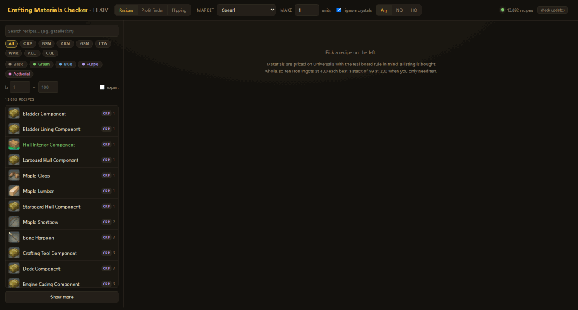
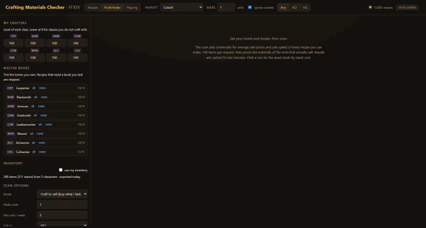
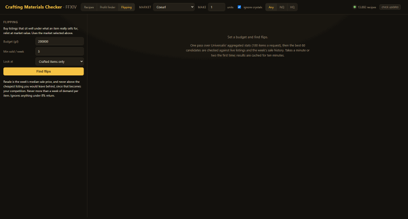

<div align="center">


# Crafting Materials Checker

**Know what a craft really costs, and what it is really worth.**

A local web app for FFXIV crafters. Every recipe in the game, priced against the live market
board through [Universalis](https://universalis.app) — with the market's own rules baked in.

[](https://github.com/biscoitorino/Crafting-Materials-Checker/releases/latest/download/CraftingMaterialsChecker-v1.0.0-win-x64.zip)

[](LICENSE)
[](https://github.com/biscoitorino/Crafting-Materials-Checker/releases/latest)




</div>

## Why not just use the cheapest price?

**Because the board sells listings whole.** You cannot take 10 Iron Ingots out of someone's
stack of 99. So "cheapest per unit" is the wrong question: if you need 10, a stack of 10 at
400 each (4,000 gil) beats a stack of 99 at 200 each (19,800 gil).

For every material this app solves that exactly — it picks the **set of listings** whose
quantities cover what you need for the lowest total, and shows you which stacks to buy, how
many spare units you end up with, and what it saved against buying cheapest-first.

It also knows the things that quietly ruin a profit estimate:

| | |
| --- | --- |
| 🏪 **NPC vendors** | 4,000+ materials are sold by NPCs for gil. When the vendor beats the board, the total uses it and tells you the vendor's name, zone and map coordinates. |
| 📊 **What actually sold** | Prices come from the week's sale **median**, capped at the cheapest live listing, so one 3,000,000 gil bait sale cannot flatter a recipe. |
| 🧾 **Sales, not units** | A stack of 33 is **one sale**, not 33. Bulk materials stop looking like fast movers. |
| 🎒 **Your inventory** | Import what you own and only the shortfall gets priced. |
| 💠 **Crystals** | One toggle to leave shards, crystals and clusters out of the maths. |
| 🎖️ **GC seals** | Expert delivery seal value and gil-per-seal for every piece of gear. |

## Three ways to use it

### 📖 Recipes

Search any of the game's **13,892 crafting recipes**. You get the in-game recipe sheet
(durability, difficulty, max quality, yield, craftsmanship recommendation, master book), the
full material list with icons, the exact stack-by-stack shopping plan, the week's sales
history, and a margin estimate. Craftable materials link to their own recipe. Set **Make N
units** and everything scales — stack maths included.

### 💰 Profit finder



Tell it your level in each class and which master books you own, then scan. It ranks
everything you can actually make by profit per unit, margin, total for a batch, or weekly
potential. Three modes:

- **Craft to sell** — buy what you lack, keep what you own.
- **Craft from what I own** — only recipes your bags already cover, with what crafting adds
  over just selling the materials raw.
- **Sell what I own as-is** — every marketable stack you hold, valued and ranked.

The top candidates are re-priced against **live listings and real sale history**, so anything
whose materials cannot actually be bought right now is dropped rather than shown as profit.

### 🔁 Flipping



Give it a gil budget. It finds listings sitting well under what the item really sells for and
turns the budget into a shopping list: which listings to buy, what to relist at, expected
profit and return.

It understands that **buying the cheap listings makes the next one your competition** — with
listings at 2,000 / 2,005 / 50,000 and a 40,000 median, it buys both cheap ones and relists at
40,000. It never plans more units than the market moved last week, and it shows how stale each
board snapshot is, because a cheap listing from six hours ago is probably already gone.

## Download

**[CraftingMaterialsChecker-v1.0.0-win-x64.zip](https://github.com/biscoitorino/Crafting-Materials-Checker/releases/latest/download/CraftingMaterialsChecker-v1.0.0-win-x64.zip)** (33 MB)
— one `.exe`, no install, no Node needed. Every release is on the
[releases page](https://github.com/biscoitorino/Crafting-Materials-Checker/releases).

1. Unzip it somewhere it is allowed to write — your Documents folder rather than Program Files.
2. Run `CraftingMaterialsChecker.exe`. Your browser opens at the app by itself.

There is no window and no tray icon: the browser page is the whole app. **stop app** in the
top right shuts it down, and it also stops on its own after twenty minutes with nobody using
it, so closing the browser and walking away is fine. Double-clicking while it is already
running reopens the page instead of starting a second copy.

The first run downloads the game data (~30 MB) into a `data` folder beside the executable and
builds its index, which takes a minute. Item icons are cached there as you browse. Nothing else
is written anywhere.

Windows SmartScreen will warn about an unsigned program the first time: **More info → Run
anyway**. Signing an executable costs money a hobby project does not have — if you would rather
not trust a binary, [run it from source](#run-from-source) or
[build it yourself](#building-the-windows-executable); it is the same code.

## Run from source

Needs [Node.js 22+](https://nodejs.org). No build step, no database, nothing to compile.

```bash
git clone https://github.com/biscoitorino/Crafting-Materials-Checker.git
cd Crafting-Materials-Checker
npm install
cp .env.example .env
npm start
```

Then open **http://127.0.0.1:8790**. Ctrl+C in the terminal stops it, or use **stop app** in
the top right of the page.

On first run it downloads the game data (~30 MB) and condenses it into `data/index.json` —
recipes, items, icons, vendors, master books and seal values. That takes a minute once.

`.env` holds the port, the item language (`en`, `de`, `fr`, `ja`) and the world shown on first
load. Everything else is remembered in the browser.

### Building the Windows executable

```bash
npm run build
```

Bundles the app, embeds the UI and lookup tables as assets, and injects the result into a copy
of the Node runtime as a [single-executable application](https://nodejs.org/api/single-executable-applications.html).
It also gives the executable its icon and switches it to a windowed program, which is what
keeps a console from appearing. Output lands in `dist/`: the `.exe` and a zip ready to attach
to a release. Windows only, since it packages a Windows runtime.

### Import your inventory (optional)

Export a list from the [Allagan Tools](https://github.com/Critical-Impact/InventoryTools)
Dalamud plugin (**Export to CSV**) and save it as `data/export.csv`. Tick **use my inventory**
and the app deducts what you already own from every material, everywhere. Items listed on the
market, equipped or in the armoury chest are not counted. Re-export any time — the file is
re-read when it changes.

## Keeping game data current

The index remembers which [Teamcraft](https://github.com/ffxiv-teamcraft/ffxiv-teamcraft)
commit it was built from. **check updates** in the header asks GitHub for the latest commit to
their data folder — one small request — and only downloads and rebuilds if it differs, hot
swapping the new data in without a restart. `npm run data` forces a rebuild.

## Where the data comes from

| What | Source |
| --- | --- |
| Recipes, items, categories, stack sizes, rarity, NPC vendors and their locations | [FFXIV Teamcraft](https://github.com/ffxiv-teamcraft/ffxiv-teamcraft/tree/staging/libs/data/src/lib/json) |
| Item icons, GC expert delivery seals, master book requirements | [XIVAPI](https://v2.xivapi.com) |
| Listings, sale history, worlds | [Universalis](https://universalis.app) |

### Being a good citizen

Universalis is a volunteer-run community service, so the app is deliberately gentle with it:
the market-wide scans use the aggregated endpoint (100 items per request), materials are only
priced for recipes that actually sell, at most three requests are in flight at once with a
pause between them, results are cached for ten minutes per market, and only one scan can run
at a time. A full scan of ~2,000 recipes is roughly 30 requests.

## How it is put together

```
src/
  index.js         entry point; --rebuild regenerates the data index
  server.js        Fastify routes and the static UI
  data.js          builds data/index.json from Teamcraft + XIVAPI
  pricing.js       stack-aware purchase planner (exact knapsack over listings)
  recipe-price.js  per-recipe costing shared by the UI and the scanners
  scan.js          profit finder
  flip.js          flipping planner
  inventory.js     Allagan Tools CSV import
  universalis.js   Universalis client
  icons.js         on-disk icon cache
  static.js        serves the UI, from disk or from inside the packaged exe
  bundle.js        tells the two apart and finds the shipped files
  desktop.js       packaged-only: log to file, open the browser, idle shutdown
public/            the UI — plain HTML, CSS and JavaScript, no framework
scripts/           release build and the icon generator
```

## Contributing

Issues and pull requests are welcome. The app is plain modern JavaScript with no build
tooling, so a clone and `npm install` is the whole setup.

## License

[MIT](LICENSE).

Not affiliated with or endorsed by Square Enix. FINAL FANTASY XIV © SQUARE ENIX CO., LTD.
Item names, icons and game data are the property of Square Enix. Prices and sale history come
from Universalis; nothing here reads or modifies the game.
